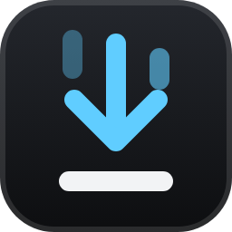
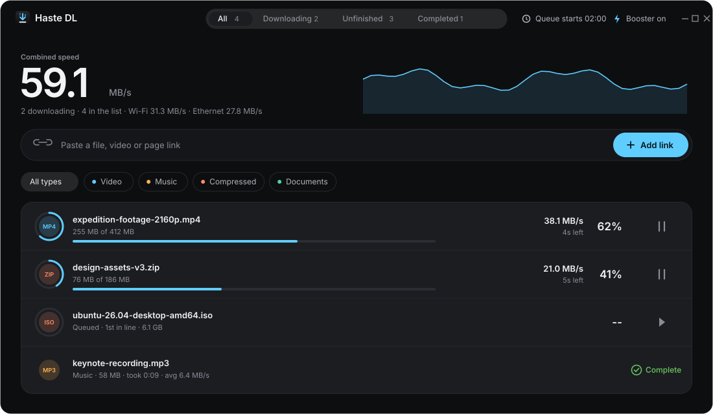
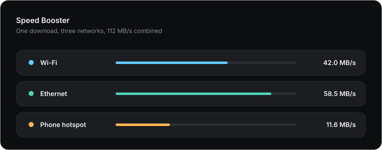
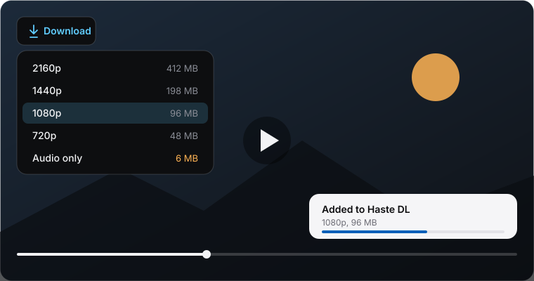

<p align="center">
  
</p>

<h1 align="center">Haste Downloader</h1>

<p align="center">
  <b>Download faster. Save any video. Keep it all private.</b><br>
  A download manager that splits every file across parallel connections, catches the video playing in your browser and delivers it as one finished file.
</p>

<p align="center">
  <a href="https://github.com/sapariyaneel/Haste-Downloader/releases/latest"></a>
</p>

<p align="center">
  
  
  
  
</p>

<p align="center">
  <a href="#download">Download</a> &bull;
  <a href="#why-haste-downloader">Why Haste DL</a> &bull;
  <a href="#features">Features</a> &bull;
  <a href="#install-in-two-minutes">Install</a> &bull;
  <a href="#faq">FAQ</a> &bull;
  <a href="#developer">Developer</a>
</p>

<p align="center">
  <picture>
    <source media="(prefers-color-scheme: light)" srcset="assets/app-light.svg">
    
  </picture>
</p>

<p align="center"><sub>The Haste DL main window, in the dark and light themes. Figures are illustrative.</sub></p>

---

## Download

**[Get the latest Windows installer](https://github.com/sapariyaneel/Haste-Downloader/releases/latest)**, then run `HasteDownloader-<version>-setup.exe`.

| Platform | Status |
|---|---|
| Windows 10 and 11, x64 and ARM64 | Available now |
| macOS 11 and later | Coming later |
| Linux | Coming later |

Setup needs no administrator rights, installs for your user only, and carries everything it needs. There is no separate runtime to install.

## Why Haste Downloader

| | |
|---|---|
| **Fast** | Every file is split across several connections, and a finished connection takes over half of the slowest one, so a single slow link never holds up the end. |
| **Complete** | Detects the video playing in your browser, lists every quality with its real size, and merges separate video and audio into one file. No ffmpeg, no extra tools. |
| **Dependable** | Pause, resume, close the app or lose power: progress is saved continuously and picks up where it stopped. |
| **Private** | No account, no telemetry. Your downloads, settings and logs stay on your computer. |

## Features

### Faster downloads

- **Segmented downloading.** Eight connections per file by default, with no upper limit in Settings. Work is rebalanced on the fly, so the last few percent do not crawl.
- **Speed Booster.** Spread a single download over several networks at once, for example Wi-Fi, Ethernet and a tethered phone, with a speed limit per network. Links tied to one address fall back automatically.
- **Queue and scheduler.** Add downloads to a queue, run a set number at a time, start at a chosen time on chosen days and stop at a set time each day. Reorder with Alt+Up and Alt+Down.

<p align="center">
  
</p>

<p align="center"><sub>Speed Booster, with illustrative figures.</sub></p>

### Video from any page

- **One-click capture.** A **Download** button appears on the video player. Pick a quality, check the name and folder, and go.
- **YouTube.** Watch, Shorts, live-page and youtu.be links, with qualities up to 2160p as H.264 or VP9 and the audio merged automatically. Requests are anonymous: no cookies are sent.
- **HLS and DASH.** Adaptive streams, byte ranges, segment templates and AES-128 encrypted HLS all work.
- **Built-in muxer.** Streams are rewrapped without re-encoding, so there is no quality loss and almost no wait: MPEG-TS to MP4 (H.264 or HEVC video, AAC or AC-3 audio), and separate video and audio to MP4 or MKV.
- **Nothing lost.** If a stream uses a codec the muxer cannot rewrap, the original `.ts` file is kept and plays in most players.

<p align="center">
  
</p>

<p align="center"><sub>The Download button on a video player.</sub></p>

### Stays out of your way

- **Takes over browser downloads.** Files started in your browser are handed to Haste DL with the site's cookies and referrer, including from private windows once you allow it. A confirmation dialog comes first.
- **Lives in the tray.** Starts with Windows, opens quietly when the browser needs it, and sends a notification when a download finishes or fails.
- **Live progress window.** Percentage, size, speed, time left and time elapsed for each download, and the total time and average speed once it completes.
- **Preview while it downloads.** Open a partly downloaded file in your player before it finishes.
- **Tidy folders.** Unfinished data waits in a temporary folder, so your download folder holds only finished files, sorted into Video, Music, Compressed, Documents, Programs and General.

### Designed to be used

- **A clean, modern interface** in dark and light themes. Every running download shows its real connections as lanes.
- **Accessible.** Full keyboard operation, screen reader support, and a layout that adapts to narrow windows.
- **Signed updates.** An update is installed only if its digital signature matches the key built into the app.

## Install in two minutes

1. **Download and run** the installer from the [latest release](https://github.com/sapariyaneel/Haste-Downloader/releases/latest). Accept the license and finish Setup.
   > The installer is not code-signed yet, so Windows SmartScreen may show a warning. Choose **More info**, then **Run anyway**. You can compare the file with the SHA-256 value shown next to it on the release page.
2. **Add the browser extension.** Setup opens a short guide; it is also in the Start menu as **Add Haste DL to your browser**.
   1. Open `chrome://extensions` (Edge: `edge://extensions`).
   2. Turn on **Developer mode**.
   3. Choose **Load unpacked** and select the `extension` folder inside the Haste Downloader install folder.
   4. In **Details**, turn on **Allow in Incognito** (Edge: **Allow in InPrivate**) to capture videos in private windows.

Browsers do not let an installer add extensions or grant private-window access, so these steps are done once by hand.

**Browsers:** Chrome, Edge, Brave, Chromium and other Chromium-based browsers, and Firefox 121 or later. Safari is not supported yet.

## Using Haste DL

- **From the browser.** Play a video and choose **Download** on the player, or use the extension icon.
- **From a link.** Paste an `http://` or `https://` address into the box at the top of the window.
- **Download later.** Save a download to the queue and set when the queue runs.
- **Speed Booster.** Open it from the top bar to choose your networks and their limits.

## What it can and cannot do

**Works with:** any file served over HTTP or HTTPS, plain video and audio files, HLS and DASH streams, and YouTube videos that are available to anonymous viewers.

**Does not support:**

| Item | Behaviour |
|---|---|
| DRM-protected media | Refused with a clear message. Haste DL does not circumvent DRM. |
| Live streams | Refused with a clear message. |
| AV1 video from YouTube | Skipped; H.264 and VP9 qualities are offered instead. |
| E-AC-3, MPEG-2 video or MP3 inside MPEG-TS | Saved as `.ts`, which plays in most players. |
| FTP, subtitle download, FLV conversion | Not supported. |

Websites change how they deliver media without notice, so a site that works today can need an update tomorrow. Please use Haste DL only for content you have the right to download.

## Privacy and security

- No account, no telemetry, no analytics. Nothing about you is sent to the author.
- Downloads, settings, the download list and logs stay on your computer.
- Cookies are used only for the request in progress and are never written to disk.
- The app accepts messages from the browser only from the current Windows user, never from other users or over the network.
- Updates are verified against a built-in signature key and downloaded only over HTTPS.

## System requirements

| | |
|---|---|
| Operating system | Windows 10 (1607 or later) or Windows 11 |
| Processor | x64 or ARM64 |
| Runtime | Nothing to install; the app carries its own |
| Browser | Chrome, Edge, Brave or another Chromium-based browser, or Firefox 121+ |

## FAQ

**Why does Windows warn me when I run the installer?** The installer is not code-signed yet, so SmartScreen does not recognise it. Choose **More info**, then **Run anyway**.

**Nothing happens when I click Download on a video.** Open Haste DL once from the Start menu to link it with the browser, then reload the extension.

**It does not capture videos in a private window.** Turn on **Allow in Incognito** (Edge: **Allow in InPrivate**) for the extension.

**A video was saved as `.ts`.** The stream uses a codec the built-in muxer cannot rewrap, such as E-AC-3. The file is complete and plays in VLC and most players.

**A YouTube video shows an error.** The message comes from YouTube, for example that the video is private or unavailable. If a site stopped working, install the latest version.

**Where are my files?** In `Downloads\HasteDL`, sorted by type, unless you chose another folder in Settings.

**Where are the logs?** In `%APPDATA%\HasteDL`: `error.log`, and `booster.log` for Speed Booster decisions.

**How do I uninstall it?** Use **Settings > Apps**. Your settings and download list are kept, and downloaded files are never touched.

## Feedback

Found a bug or have an idea? [Open an issue](https://github.com/sapariyaneel/Haste-Downloader/issues). Please include your Windows version and, for a failed download, the relevant lines from `error.log` with any private links removed.

## License

Haste Downloader is proprietary software. It is not open source, and it may not be copied, modified or redistributed. See the [LICENSE](LICENSE) file for the full agreement, which Setup also presents for acceptance. All rights reserved.

## Third-party notices

**.NET 8** (Microsoft and the .NET Foundation) and **Avalonia** (the Avalonia project) are included in the application under the MIT license. The **Archivo** typeface is used under the SIL Open Font License.

## Developer

```
Developer: Neel Sapariya
GitHub:    github.com/sapariyaneel
Twitter/X: @sapariyaneel_
LinkedIn:  linkedin.com/in/neelsapariya
Portfolio: https://neelsapariya.in
```
